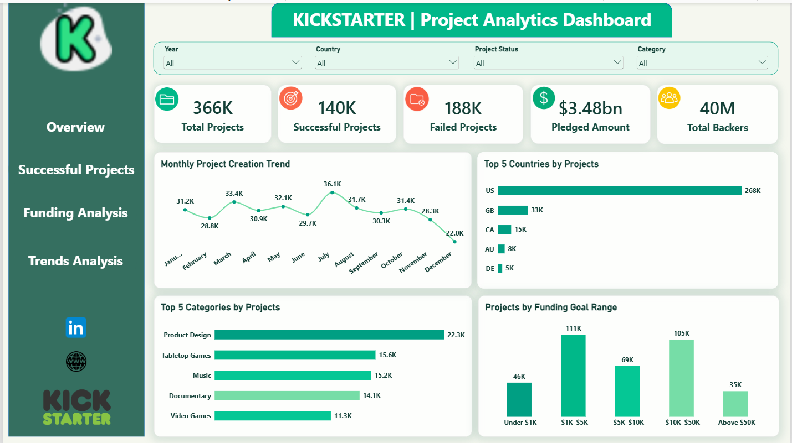
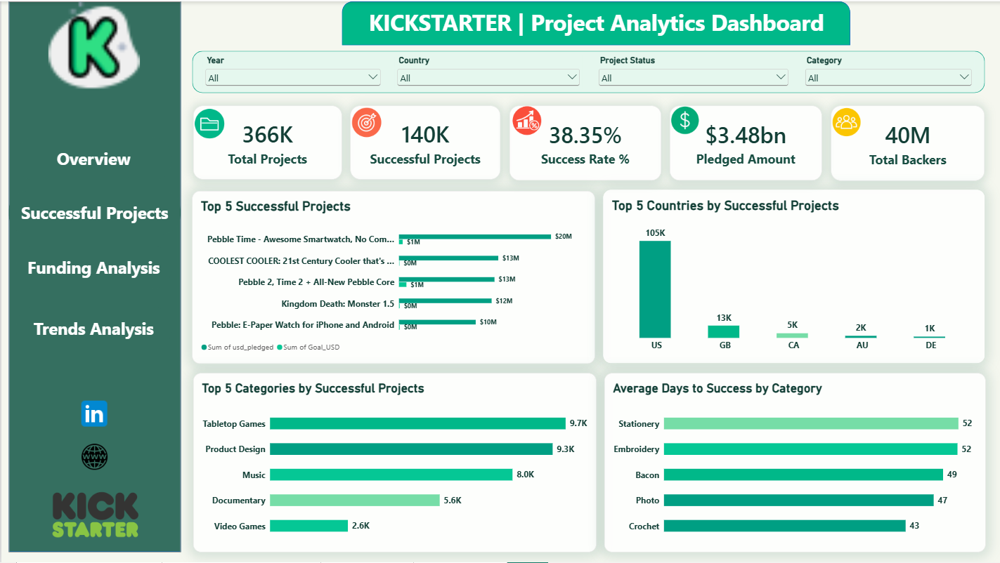
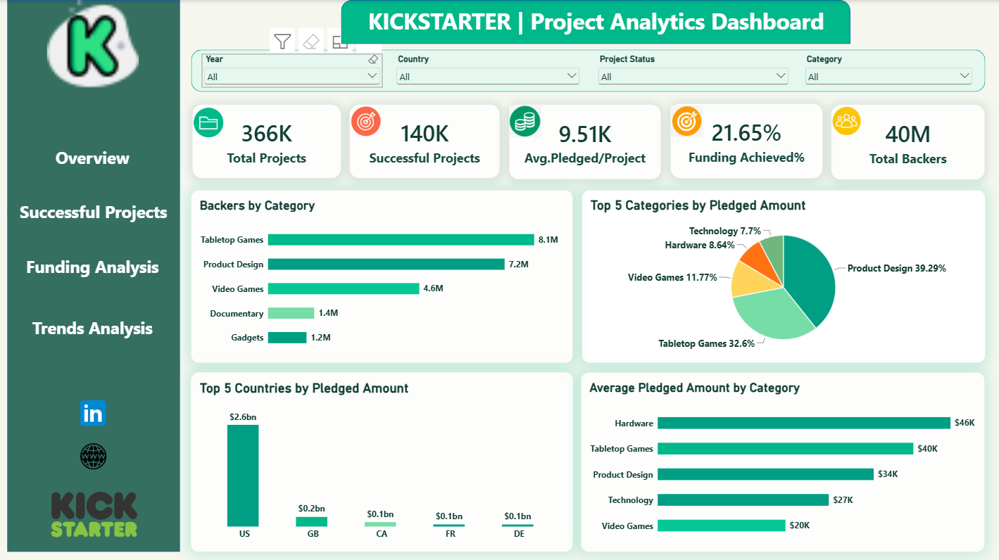
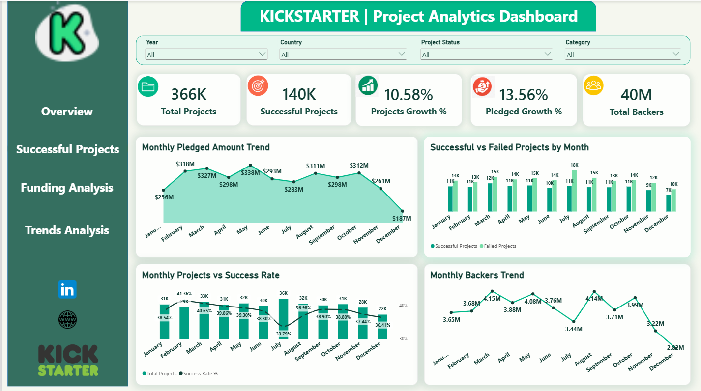
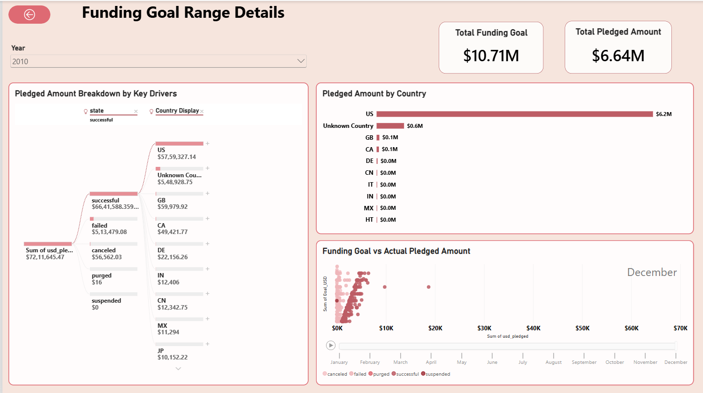
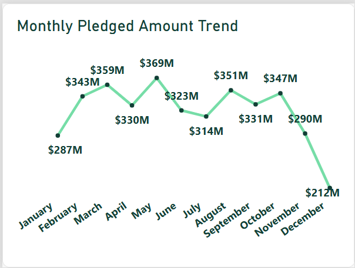
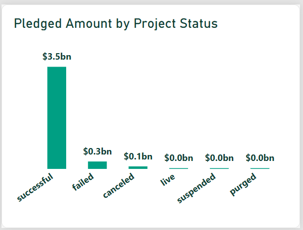

# Kickstarter Project Analytics Dashboard | Power BI

## Project Overview

An interactive **Power BI Kickstarter crowdfunding dashboard** for exploring project success, funding performance, pledged amounts, category and country patterns, and monthly trends. The report includes four **bookmark-driven dashboard views**, a **Funding Goal Range drillthrough page**, and **two advanced report tooltips**.

## Dashboard KPIs

Representative values from the unfiltered overview screenshots:

| KPI | Value |
| --- | ---: |
| Total Projects | 366K (approx.) |
| Successful Projects | 140K (approx.) |
| Failed Projects | 188K (approx.) |
| Pledged Amount | $3.48B (approx.) |
| Total Backers | 40M (approx.) |
| Success Rate (successful-project view) | 38.35% |

> Values shown are rounded screenshots of the Power BI report and may change when slicers or drillthrough filters are applied. The 'Total Backers' value is an aggregate from the project data, not a verified count of unique individuals.

## Tools & Technologies

- Microsoft Power BI Desktop
- Power Query and data preparation
- Power BI data modeling and calculated KPIs
- Data visualization and interactivity
- Bookmarks, slicers, drillthrough, and report page tooltips

## Report Views

### 1. Overview
- Total projects, successful projects, failed projects, pledged amount, and backers
- Monthly project creation trend
- Top five countries and categories by project count
- Project distribution by funding-goal range

### 2. Successful Projects
- Top five successful projects by pledged amount versus goal
- Top countries and categories by successful projects
- Average days to success by category
- Overall project success rate

### 3. Funding Analysis
- Average pledged amount per project and funding achievement KPI
- Backer totals by category
- Top categories and countries by pledged amount
- Average pledged amount by category

### 4. Trends Analysis
- Monthly pledged amount and backers trends
- Monthly successful versus failed projects
- Project count versus success rate
- Project growth and pledged growth KPIs

### Advanced Interactions
- **Funding Goal Range Drillthrough:** Goal versus pledged amounts, country breakdown, decomposition tree, and a scatter plot
- **Tooltip 1:** Monthly pledged amount trend
- **Tooltip 2:** Pledged amount by project status
- **Bookmarks:** Switch between Overview, Successful Projects, Funding Analysis, and Trends Analysis
- **Slicers:** Year, Country, Project Status, and Category

## Dashboard Screenshots

### 1. Project Overview

### 2. Successful Projects

### 3. Funding Analysis

### 4. Trends Analysis

### 5. Funding Goal Range — Drillthrough

### 6. Monthly Pledged Amount — Tooltip

### 7. Pledged Amount by Status — Tooltip

## How to Use

1. Download `Final_Project_v3.pbix` from this repository’s **Releases** section, or clone with Git LFS if the `.pbix` is tracked there.
2. Open it with **Microsoft Power BI Desktop**.
3. Use the sidebar navigation and the Year, Country, Project Status, and Category slicers.
4. Select relevant visuals for drillthrough or hover to view the report tooltips.

## Download Power BI Project

[Download Kickstarter Project Analytics Dashboard (.pbix)](https://github.com/Atiya2005/Kickstarter-Project-Analytics-Power-BI/releases/download/v1.0.0/Final_Project_v3.pbix)

Open the downloaded file using Microsoft Power BI Desktop.

> **Large file note:** The `.pbix` exceeds GitHub's 100 MiB regular Git limit. It can be shared as a downloadable **GitHub Release asset** (simplest browser-based option) or tracked with **Git LFS**. The screenshots and README are viewable directly on GitHub.

## Author

**Atiya Dabir**

*Portfolio project demonstrating Power BI reporting, crowdfunding analytics, and interactive business intelligence visualizations.*
